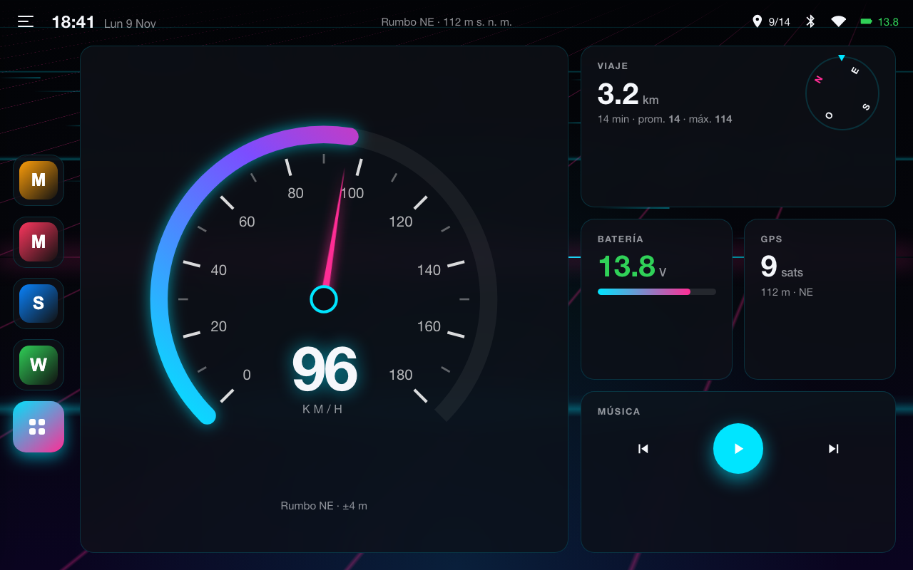
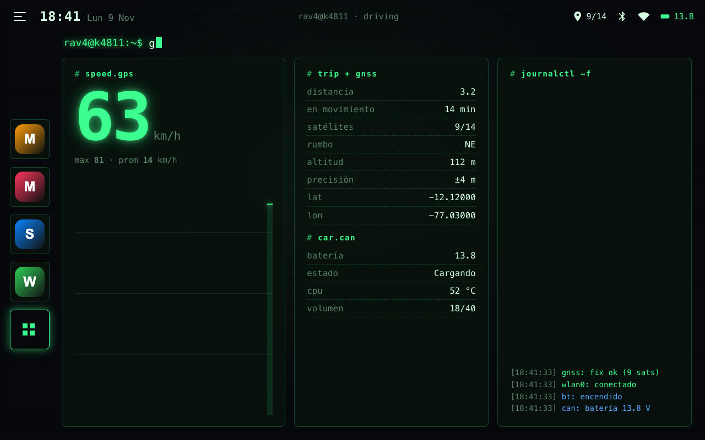
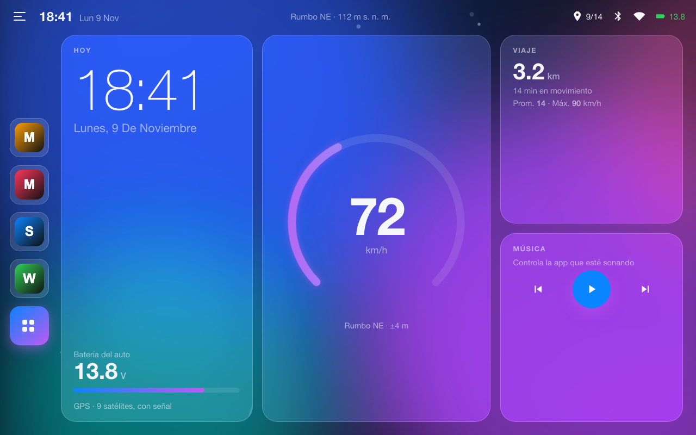
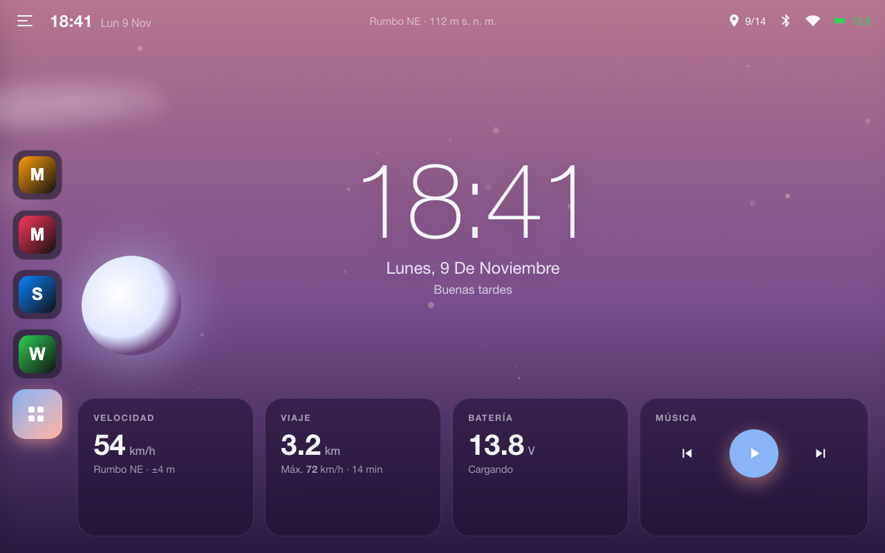
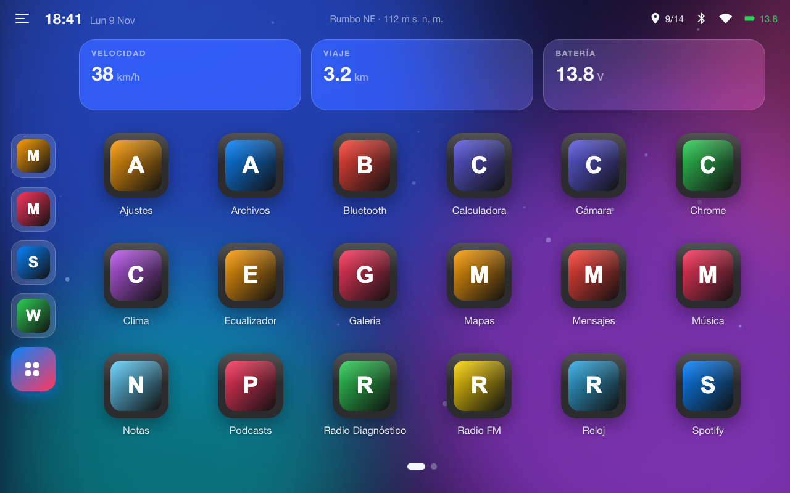
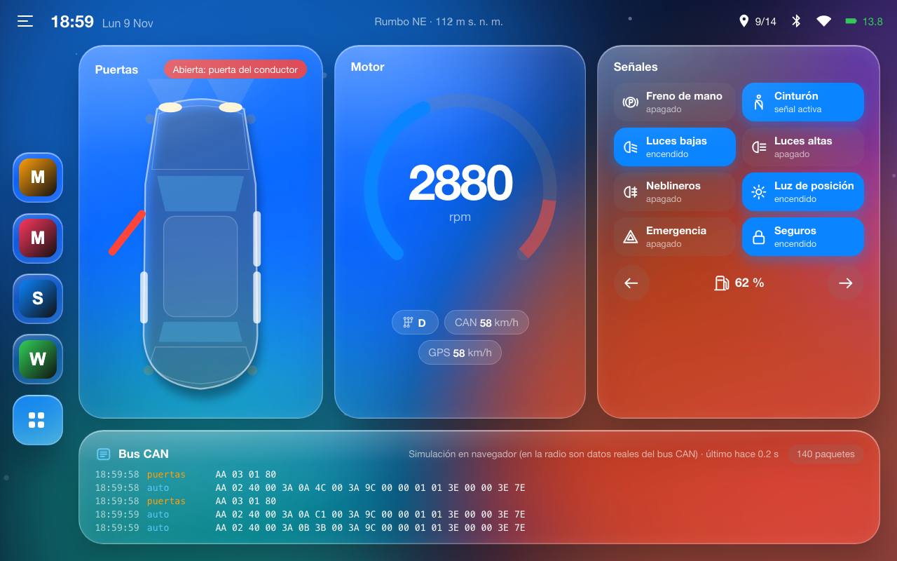
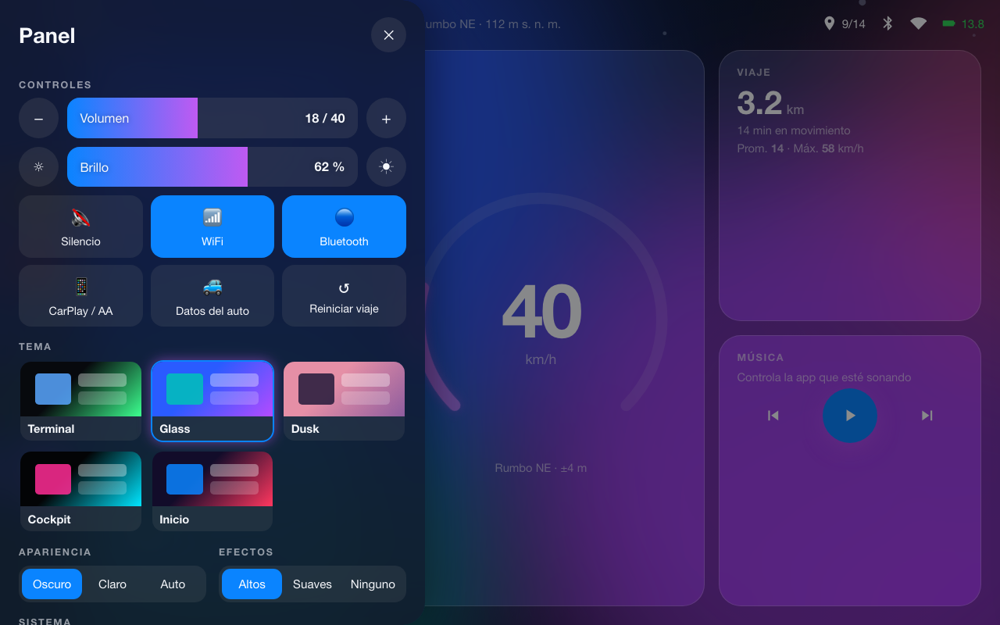

# RAV4 Launcher

[](https://github.com/SebastianEPH/rav4-launcher/releases/latest)
[](https://github.com/SebastianEPH/rav4-launcher/actions/workflows/release.yml)
[](https://sebastianeph.github.io/rav4-launcher/)

Launcher (pantalla de inicio) hecho a medida para una **autorradio Android china NWD K4811**
montada en un **Toyota RAV4 2013**. No es solo un lanzador de apps: muestra la velocidad y el
viaje por GPS, el voltaje de la batería del auto (vía CAN), controla el volumen real de la radio
y se **actualiza solo desde GitHub**.

**▶ [Probar la demo interactiva en el navegador](https://sebastianeph.github.io/rav4-launcher/)**
(con datos simulados: arrastra con el mouse → para abrir el panel y ← para las apps).



## Temas

La interfaz web trae 6 temas animados y muy configurables (modo claro/oscuro/automático por horas, color de acento,
reloj 12/24 h y opciones propias de cada tema). Los 5 primeros existen también en versión nativa (Java).

| Terminal | Glass | Dusk |
|:---:|:---:|:---:|
|  |  |  |
| Consola con efecto CRT, comandos que se teclean solos, log en vivo de GPS, WiFi, CAN y volumen | Tarjetas de vidrio sobre una aurora animada; anillo de velocidad con degradado | Cielo que cambia según la hora (amanecer, día, atardecer, noche) con sol, luna, nubes y estrellas |

| Cockpit | Inicio | Auto · CAN |
|:---:|:---:|:---:|
|  |  |  |
| Velocímetro SVG con aguja, brújula y carretera neón que corre según la velocidad real | Cuadrícula de íconos grandes con páginas y widgets de velocidad, viaje y batería | Vidrio líquido estilo iOS: puertas animadas, tacómetro, luces y registro en vivo del **bus CAN** |



El **Panel** (deslizar →) reúne volumen, brillo, WiFi, Bluetooth, tema, opciones del tema, horario del modo oscuro, color de acento y actualización.

## Características

**Datos del auto**
- 🚗 **Velocidad por GPS** con velocímetro animado, máxima, promedio, distancia y tiempo en movimiento.
- 🧭 Rumbo, altitud, precisión y satélites en uso.
- 🔋 **Voltaje de la batería del auto** leído por el bus CAN de la radio, con aviso de carga o batería baja.
- 🚪 **Bus CAN en vivo** (tema Auto · CAN): puertas, maletero, capó, RPM, velocidad del auto, freno de mano, cinturón, luces, direccionales, marcha y combustible, más un registro de cada paquete. Se lee del servicio CAN de la radio (detalle en `FINDINGS.md`).
- 🌡️ Temperatura del CPU, memoria, red y tiempo encendido (tema Terminal).

**Control de la radio**
- 🔊 **Volumen real de la radio** (el sistema NWD, escala 0–40, no el volumen estándar de Android).
- ☀️ Brillo con un **mínimo de 18 %**: por debajo, la pantalla de esta radio se apaga. El launcher lo vigila y lo corrige.
- 📶 WiFi, Bluetooth, multimedia (anterior / play / siguiente), acceso a CarPlay / Android Auto (ZLINK) y a los datos del auto.
- 🗑️ **Desinstalar apps del sistema** usando el servicio root del firmware, con lista de apps protegidas.

**Launcher**
- 🎨 Dos interfaces: **Nativa** (Java, la más liviana) y **Web animada** (HTML/CSS/JS en un WebView).
- ✨ Efectos Altos / Suaves / Ninguno; si la radio no da ~35 fps, se bajan solos.
- ⚙️ **Ajustes RAV4**: app aparte (con su ícono) para tema, apariencia, interfaz, permisos y actualización; el launcher queda liviano.
- 👆 Deslizar **← abre las apps**. Mantén presionada una app para fijarla en el dock, ocultarla o desinstalarla.
- 🌗 Modo oscuro, claro o automático según la hora.
- ⬆️ **Actualización desde el propio launcher**: busca el último Release, lo descarga e instala encima.

## Instalación

1. Descarga `RAV4Launcher-vX.Y.Z.apk` desde [Releases](https://github.com/SebastianEPH/rav4-launcher/releases/latest).
2. Cópialo a un USB, instálalo en la radio y elígelo como launcher predeterminado.
3. Para la interfaz animada: ⚙ **Ajustes del launcher → Interfaz → Web (animada)**.

De ahí en adelante se actualiza solo: **Ajustes RAV4 → Buscar actualización**. La primera
vez Android pide permitir "instalar apps de esta fuente".

> La radio tiene el USB bloqueado en modo host por firmware (no hay ADB), así que cada versión se
> prueba instalándola en la radio real.

## La radio

| Dato | Lo que dice | Lo real |
|---|---|---|
| Android | 14 | **Android 10 (API 29)**, maquillado por el fabricante |
| SoC | — | Unisoc UIS8581A, 8 núcleos |
| Fabricante / plataforma | — | NWD K4811 |
| Pantalla | — | 1280×800, 160 dpi |
| RAM / ROM | 8 GB / 128 GB | Probablemente exagerado |

Los broadcasts privados de NWD (volumen, voltaje, desinstalación root) se descubrieron
descompilando las apps del sistema. Detalle en [`FINDINGS.md`](FINDINGS.md).

## Desarrollo

```bash
./build.sh                                   # genera RAV4Launcher.apk
open assets/web/index.html                   # probar la interfaz web en el Mac (simulador)
```

Proyecto **sin Gradle**: `aapt2 + javac + d8 + apksigner`. Requiere Java 17 y el Android
command-line SDK (rutas en `build.sh`).

La interfaz web acepta parámetros para probar: `?theme=cockpit&kmh=90&panel=1&drawer=1&fx=low`.
Las capturas de `docs/img/` se generan con Chrome sin ventana:

```bash
"/Applications/Google Chrome.app/Contents/MacOS/Google Chrome" --headless=new --hide-scrollbars \
  --window-size=1280,800 --virtual-time-budget=6000 --screenshot=docs/img/cockpit.png \
  "file://$PWD/assets/web/index.html?shot=1&theme=cockpit&kmh=96"
```

### CI / CD
- **`release.yml`**: cada push a `main` compila, firma con la misma clave (secreto `KEYSTORE_B64`)
  y publica un Release `v1.3.<n>` con el APK. Es lo que consume el botón "Buscar actualización".
- **`pages.yml`**: publica la demo interactiva en la rama `gh-pages` → GitHub Pages.

### Estructura

```
src/pe/radio/rav4/
  HomeActivity.java   interfaz nativa: 5 temas, dock, cajón, centro de control, GPS, volumen, batería
  Theme.java          paletas, íconos squircle, fondos
  Views.java          velocímetro, gráfico, gestos, fondos dibujados
  WebHome.java        WebView + puente JS "Radio" hacia los datos reales
  CanBridge.java      lectura del bus CAN vía el servicio AIDL de la radio
  Updater.java        actualización desde GitHub Releases
assets/web/           interfaz web: index.html, app.css, app.js (+ simulador para navegador)
site/                 página de GitHub Pages
docs/img/             capturas
```

Más contexto: [`CLAUDE.md`](CLAUDE.md) (proyecto y radio), [`DESIGN.md`](DESIGN.md) (reglas de UI),
[`FINDINGS.md`](FINDINGS.md) (ingeniería inversa de las apps NWD).
